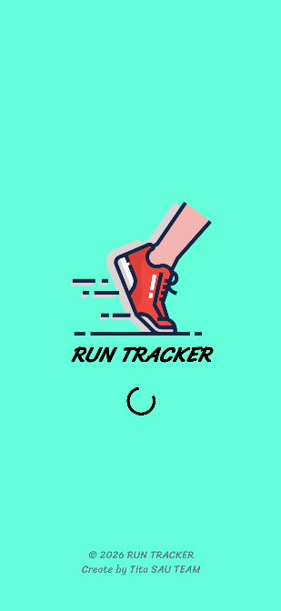
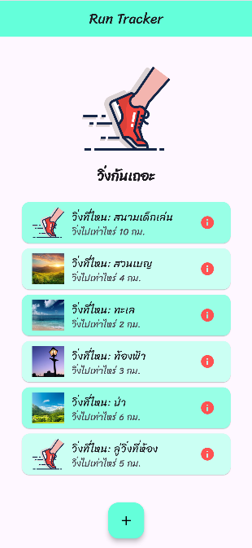
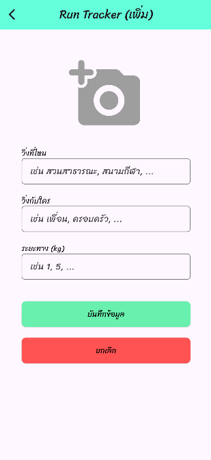
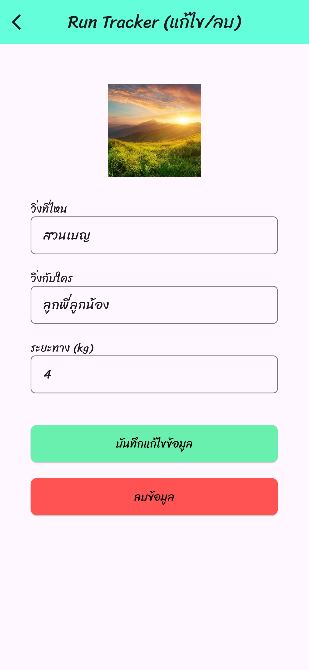

# flutter run tracker app

โปรเจกต์ **flutter run tracker app (Run Tracker)** เป็นโปรเจกต์สำหรับรายวิชา **Mobile Development** จัดทำขึ้นเพื่อฝึกการพัฒนา Mobile Application ด้วย **Flutter และ Dart**

แอปพลิเคชันสำหรับบันทึกและจัดการข้อมูลการวิ่งของผู้ใช้งาน โดยสามารถแสดงรายการบันทึกการวิ่ง เพิ่มข้อมูลการวิ่งใหม่ แก้ไขข้อมูลเดิม และลบข้อมูลที่ไม่ต้องการได้ พร้อมเชื่อมต่อกับ Supabase สำหรับจัดเก็บและจัดการข้อมูล และรองรับการเลือกรูปภาพจากอุปกรณ์เพื่อประกอบข้อมูลการวิ่ง

## 🧩 Details UI

- **SplashScreenUI** — หน้าจอเริ่มต้นของแอป แสดงโลโก้และชื่อแอปประมาณ 3 วินาที จากนั้นเปลี่ยนไปยัง `ShowAllRunUI`
- **ShowAllRunUI** — หน้าจอหลักสำหรับแสดงรายการบันทึกการวิ่งทั้งหมดของผู้ใช้งาน พร้อมตัวเลือกสำหรับเพิ่มข้อมูลใหม่และเข้าดูรายละเอียดเพื่อแก้ไขหรือลบข้อมูลการวิ่ง
- **AddRunUI** — หน้าจอสำหรับเพิ่มบันทึกการวิ่งใหม่ โดยผู้ใช้งานสามารถกรอกข้อมูลการวิ่งและเลือกรูปภาพจากอุปกรณ์ ก่อนบันทึกข้อมูลลงใน Supabase
- **UpdateDeleteRunUI** — หน้าจอสำหรับแสดงรายละเอียด แก้ไขข้อมูลการวิ่งที่บันทึกไว้ และลบรายการที่ไม่ต้องการออกจากระบบ

## 🎨 Pages / UI

โปรเจกต์ประกอบด้วยหน้าจอดังต่อไปนี้:

| SplashScreenUI | ShowAllRunUI | AddRunUI | UpdateDeleteRunUI |
|---|---|---|---|
|  |  |  |  |

## 🛠️ Technologies

- **Flutter** — UI Framework
- **Dart** — Programming Language
- **Material Design** — UI Components เช่น `Scaffold`, `AppBar`, `Card` และ `ListTile`
- **Google Fonts** — ใช้ฟอนต์ **sriracha** เป็นฟอนต์หลักของแอป
- **Font Awesome Flutter** — ใช้แสดงไอคอนต่างๆ เพื่อเพิ่มความสวยงามและช่วยให้ผู้ใช้งานเข้าใจการทำงานของปุ่มต่างๆ
- **supabase flutter** — ใช้เชื่อมต่อกับ Supabase สำหรับจัดเก็บ เรียกดู เพิ่ม แก้ไข และลบข้อมูลการวิ่ง
- **image picker** — ใช้เลือกรูปภาพจากอุปกรณ์เพื่อนำมาใช้งานภายในแอปพลิเคชัน
- **flutter dotenv** — ใช้จัดการค่าคอนฟิกของแอปพลิเคชันผ่านไฟล์ .env เช่น Supabase URL และ Publishable Key

## 📂 Project Structure

```text
lib/
├── main.dart
├── models/
│   └── run.dart
├── services/
│   └── supabase_service.dart
└── views/
    ├── splash_screen_ui.dart
    ├── show_all_run_ui.dart
    ├── add_run_ui.dart
    └── update_delete_run_ui.dart
```

## 🎯 Project Objectives

โปรเจกต์นี้จัดทำขึ้นเพื่อ:

- เรียนรู้การพัฒนา Mobile Application ด้วย Flutter และ Dart
- ฝึกออกแบบและพัฒนา User Interface (UI) สำหรับการแสดงและจัดการข้อมูลการวิ่ง
- เรียนรู้การเชื่อมต่อแอปพลิเคชันกับ Supabase เพื่อจัดเก็บและจัดการข้อมูล
- ฝึกพัฒนาระบบ CRUD (Create, Read, Update, Delete) สำหรับจัดการบันทึกการวิ่ง
- เรียนรู้การใช้งาน Image Picker เพื่อเลือกรูปภาพจากอุปกรณ์
- ฝึกจัดโครงสร้างโปรเจกต์โดยแยก Models, Services และ Views เพื่อให้ง่ายต่อการพัฒนาและบำรุงรักษา

## 👩‍💻 My Contribution

ส่วนที่พัฒนาในโปรเจกต์นี้:

- ออกแบบและพัฒนา UI ของแอปพลิเคชันด้วย Flutter และ Material Design
- พัฒนาหน้าจอ Splash Screen และระบบนำทางระหว่างหน้าจอต่าง ๆ
- พัฒนาหน้าจอแสดงรายการบันทึกการวิ่งทั้งหมด
- พัฒนาฟอร์มสำหรับเพิ่มและแก้ไขข้อมูลการวิ่ง
- พัฒนาฟังก์ชันสำหรับลบข้อมูลการวิ่ง
- เชื่อมต่อ Supabase เพื่อจัดเก็บและจัดการข้อมูลผ่าน Service
- เพิ่มความสามารถในการเลือกรูปภาพจากอุปกรณ์ด้วย Image Picker

## 📚 Course

**Course:** Mobile Development  
**Project:** flutter run tracker app